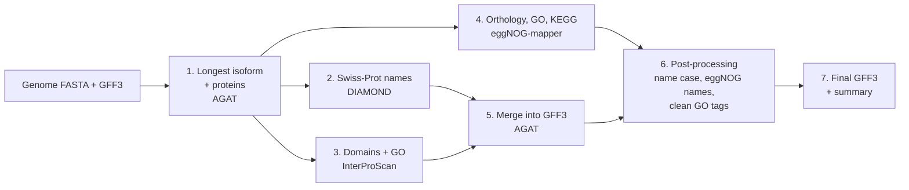

# Functional annotation

A simple, resumable pipeline for the **functional annotation of vertebrate genomes**. It takes a genome assembly and a structural annotation (for example from BRAKER) and adds gene names, protein domains, GO terms and KEGG pathways. It combines three complementary sources of evidence:

| Source | Tool | What it adds |
|---|---|---|
| UniProtKB/Swiss-Prot | DIAMOND | Gene names and product descriptions from manually reviewed proteins |
| InterPro member databases | InterProScan | Protein domains and families (Pfam, PANTHER, Gene3D, CDD, SMART, ...) and GO terms |
| eggNOG orthology | eggNOG-mapper | Orthology-based names, GO terms, KEGG KO/pathways, EC numbers, COG categories |

The results are merged into a single GFF3 with AGAT, and a summary table reports the percentage of genes annotated by each source, ready for a genome resource paper.

## Workflow



1. **Longest isoform per gene.** AGAT keeps one transcript per gene (the longest CDS) and translates it. This avoids redundant searches and gives clean per-gene percentages.
2. **Swiss-Prot.** DIAMOND blastp, best hit with e-value < 1e-5 and at least 50% coverage of both query and subject.
3. **InterProScan.** All member databases available in your installation, with InterPro entries and GO terms.
4. **eggNOG-mapper.** DIAMOND mode, against eggNOG 5.0.
5. **Merge.** AGAT writes Swiss-Prot names and InterProScan domains/GO into the GFF3.
6. **Post-processing.** Harmonises gene-symbol case, names unnamed genes from eggNOG, and removes non-standard GO source tags.
7. **Summary.** Percentages per source, the species of the Swiss-Prot entries used for naming, and software versions.

Every step is skipped when its output already exists, so a job that crashes or times out can simply be resubmitted.

## Requirements

- Linux, bash, conda (or mamba)
- [AGAT](https://github.com/NBISweden/AGAT) and [DIAMOND](https://github.com/bbuchfink/diamond) (`envs/annot.yml`)
- [eggNOG-mapper](https://github.com/eggnogdb/eggnog-mapper) v2 (`envs/emapper.yml`)
- [InterProScan 5](https://interproscan-docs.readthedocs.io/) with Java 11 or newer
- About 55 GB of disk for the databases
- SLURM is optional: the script also runs with plain `bash`

## Installation

```bash
git clone https://github.com/<your-username>/functional-annotation.git
cd functional-annotation

conda env create -f envs/annot.yml
conda env create -f envs/emapper.yml
```

AGAT, DIAMOND and eggNOG-mapper go in separate environments because their Perl, Python and DIAMOND dependencies can clash.

**InterProScan** is best taken from your cluster's module system or installed from the [official release](https://interproscan-docs.readthedocs.io/en/latest/HowToDownload.html). The bioconda package often lags behind the data releases. Example with environment modules:

```bash
module load openjdk/17.0.8
module load interproscan/5.75-106.0
interproscan.sh -version
```

## Configuration

All settings live in a config file, so the pipeline script itself never needs editing:

```bash
cp config/config.example.sh config/my_species.sh
nano config/my_species.sh
```

The main settings are:

| Variable | Meaning |
|---|---|
| `SPECIES` | Prefix for all output files |
| `GENOME`, `GFF` | Assembly and structural annotation (all isoforms) |
| `OUTDIR` | Output folder |
| `DB_DIR`, `EGGNOG_DB` | Database folders |
| `CONDA_SETUP`, `IPR_SETUP` | Commands that make conda and InterProScan available (for example `module load ...`) |
| `IPR_OFFLINE` | `yes` if compute nodes have no internet. This disables the InterPro lookup service and makes InterProScan several times slower |
| `IPR_APPL` | Empty to run all member databases, or a comma-separated subset |
| `EMAPPER_TAX_SCOPE` | `auto`, or a clade such as `Vertebrata`, `Aves`, `Mammalia` |
| `NAME_CASE` | `upper` or `keep` (see [Gene-symbol case](#gene-symbol-case)) |
| `EGGNOG_NAME_FALLBACK` | Name genes without a Swiss-Prot hit from eggNOG's `Preferred_name` |
| `CLEAN_GO_TAGS` | Remove the `(InterPro)`/`(PANTHER)` tags from GO terms |

## Databases

Download once, on a machine with internet access (often the login node):

```bash
bash scripts/download_databases.sh config/my_species.sh
```

This fetches and indexes UniProtKB/Swiss-Prot, plus the eggNOG 5.0.2 data (`eggnog.db`, `eggnog.taxa.db`, `eggnog_proteins.dmnd`). The eggNOG files come directly from `eggnog5.embl.de`, because `download_eggnog_data.py` in some eggNOG-mapper releases still points to a retired host and fails with `unable to resolve host address 'eggnogdb.embl.de'`.

## Running

```bash
# SLURM
sbatch functional_annotation.sh config/my_species.sh

# or directly
bash functional_annotation.sh config/my_species.sh
```

The default request is 16 CPUs, 64 GB of RAM and 3 days. Adjust the `#SBATCH` lines for your cluster and add `--partition`/`--account` if required. Check the real usage afterwards with `seff <jobID>`.

Approximate runtimes for about 20,000 genes on 16 CPUs:

| Step | Time |
|---|---|
| AGAT steps | minutes |
| DIAMOND vs Swiss-Prot | ~1–2 min |
| InterProScan, offline (`-dp`) | ~6 h |
| InterProScan with lookup service | usually < 1 h |
| eggNOG-mapper, `more-sensitive` | ~5–6 h |

If the queue allows, steps 2–4 are independent and could run as separate jobs after step 1.

## Outputs

```
OUTDIR/
├── 01_proteins/        longest-isoform GFF3 and protein FASTA
├── 02_swissprot/       DIAMOND hits (BLAST outfmt 6)
├── 03_interproscan/    InterProScan TSV, GFF3, XML
├── 04_eggnog/          *.emapper.annotations (GO, KEGG, EC, COG per gene)
├── 05_merged/          raw AGAT output
└── 06_final/
    ├── SPECIES.functional.gff3                  final annotation
    ├── SPECIES.functional_annotation_summary.tsv
    ├── SPECIES.swissprot_species.txt            species of the naming hits
    └── SPECIES.software_versions.txt            for the methods section
```

An annotated mRNA in the final GFF3 looks like this:

```
mRNA ... ID=g17774.t1;Parent=g17774;Dbxref=CDD:cd00086,InterPro:IPR001356,Pfam:PF00046,PANTHER:PTHR46271,...;
Name=RX2;Ontology_term=GO:0003677,GO:0000981,GO:0006355;evalue=3.72e-183;os=Gallus gallus;
product=Retinal homeobox protein Rx2;uniprot_id=Q9PVX0
```

Genes named from eggNOG carry `name_source=eggNOG`. The eggNOG KEGG and GO annotations stay in `04_eggnog/*.emapper.annotations`, which is the table to use for enrichment analyses.

### Summary table

| Category | Meaning |
|---|---|
| `swissprot_hit` | Genes with a Swiss-Prot hit passing the filters |
| `named_final` | Genes with a `Name` in the final GFF3 (Swiss-Prot + eggNOG fallback) |
| `interproscan_any` | Any InterProScan match, including Coils and MobiDBLite |
| `interpro_entry` | Matches integrated into an InterPro entry. Report this as the domain figure |
| `pfam` | Pfam domains |
| `go_interproscan`, `go_eggnog`, `go_any` | GO terms per source and their union |
| `eggnog_hit`, `kegg_ko` | eggNOG ortholog assigned, KEGG KO assigned |
| `any_annotation` | Union of Swiss-Prot, InterPro entry and eggNOG |

Example from a bird genome with 19,476 genes:

| Category | Genes | % |
|---|---|---|
| Swiss-Prot hit | 13,243 | 68.0 |
| InterPro entry | 15,576 | 80.0 |
| Pfam | 14,530 | 74.6 |
| eggNOG ortholog | 16,673 | 85.6 |
| KEGG KO | 11,936 | 61.3 |
| GO (either source) | 15,438 | 79.3 |
| Any annotation | 18,263 | 93.8 |

## Notes for vertebrate genomes

### Mammalian bias in Swiss-Prot names

Swiss-Prot is dominated by human, mouse and rat entries, so for non-mammalian vertebrates most best hits are mammalian proteins (check `SPECIES.swissprot_species.txt`). For naming this is usually fine: orthologues share gene symbols across vertebrates, and the e-value and coverage filters keep only strong hits. Be careful with:

- gene families with lineage-specific duplications or losses, where the best hit may be a paralogue;
- lineage-specific genes (for example avian keratins, olfactory receptors, MHC), which may have no good match.

For candidate genes, check orthology properly, for example with reciprocal best hits against a closely related Ensembl proteome, or with OrthoFinder. Complex immune regions such as the MHC need targeted annotation.

### Gene-symbol case

Mouse and rat symbols are capitalised (`Lman1`), while most vertebrate nomenclatures, including human (HGNC), chicken and other birds, reptiles and amphibians (Xenbase), use uppercase (`LMAN1`).

- `NAME_CASE="upper"` (default) uppercases the `Name` attribute and keeps `orf` lowercase in open-reading-frame names (`C1orf112`).
- `NAME_CASE="keep"` leaves symbols as they come from Swiss-Prot. Use this for mouse and rat, and for zebrafish and other fish (ZFIN convention is lowercase, `lman1`), where you may prefer to lowercase the names yourself.

Only `Name` is changed; `product` and the other attributes are untouched. AGAT appends `_1`, `_2`, ... when several genes get the same name. This is expected for gene families and for genes split into several models.

### InterProScan pathways

`-pa` (MetaCyc and Reactome) is deliberately not used. MetaCyc is mostly microbial and plant metabolism, and Reactome terms are transferred by domain, not by orthology. KEGG pathways from eggNOG are a better choice for vertebrates.

## Troubleshooting

| Message | Cause and fix |
|---|---|
| `Unknown option: g` (AGAT) | Recent AGAT versions bundle single-dash options, so `-gff` is read as `-g -f -f`. The pipeline uses long options (`--gff`) |
| `module ... cannot be loaded due to missing prereq: openjdk` | Load Java first: `IPR_SETUP="module load openjdk/17.0.8 interproscan/..."` |
| `unable to resolve host address 'eggnogdb.embl.de'` | Use `scripts/download_databases.sh`, which downloads from `eggnog5.embl.de` |
| `DIAMOND database ... eggnog_proteins.dmnd not present` | The eggNOG download failed; rerun the download script |
| `mkdir: cannot create directory '/path'` | The config still contains placeholder paths. Check with `grep '/path/to' config/my_species.sh` |
| `bc: command not found` / percentages `0,0` | Fixed: the summary uses `awk` and `LC_NUMERIC=C` |
| InterProScan fails on `*` characters | Stop codons are removed during protein extraction |
| Home quota exceeded while creating conda envs | Set `conda config --add envs_dirs` and `pkgs_dirs` to project space |

## Citation

If you use this pipeline, please cite the underlying tools:

- **AGAT**: Dainat J. *et al.* AGAT: Another Gff Analysis Toolkit to handle annotations in any GTF/GFF format. Zenodo. https://doi.org/10.5281/zenodo.3552717
- **DIAMOND**: Buchfink B., Reuter K., Drost H.-G. (2021) Sensitive protein alignments at tree-of-life scale using DIAMOND. *Nature Methods* 18, 366–368. https://doi.org/10.1038/s41592-021-01101-x
- **InterProScan**: Jones P. *et al.* (2014) InterProScan 5: genome-scale protein function classification. *Bioinformatics* 30, 1236–1240. https://doi.org/10.1093/bioinformatics/btu031
- **InterPro**: Blum M. *et al.* (2025) InterPro: the protein sequence classification resource in 2025. *Nucleic Acids Research* 53, D444–D456. https://doi.org/10.1093/nar/gkae1082
- **eggNOG-mapper**: Cantalapiedra C.P. *et al.* (2021) eggNOG-mapper v2. *Molecular Biology and Evolution* 38, 5825–5829. https://doi.org/10.1093/molbev/msab293
- **eggNOG 5.0**: Huerta-Cepas J. *et al.* (2019) *Nucleic Acids Research* 47, D309–D314. https://doi.org/10.1093/nar/gky1085
- **UniProt**: The UniProt Consortium (2025) UniProt: the Universal Protein Knowledgebase in 2025. *Nucleic Acids Research* 53, D609–D617. https://doi.org/10.1093/nar/gkae1010

## Author

Roberto Biello, Globe Institute, University of Copenhagen

## License

MIT, see [LICENSE](LICENSE).
